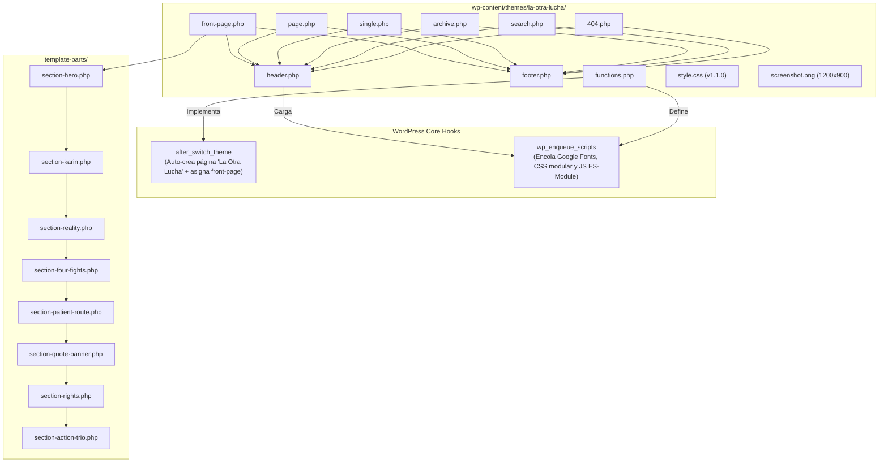

# 02 — System Design Document (SDD)

## 1. Visión General del Diseño

El sistema está implementado como un **Theme Clásico/Híbrido de WordPress** (`wp-content/themes/la-otra-lucha/`), basado en la maquetación web de alta fidelidad:

1. **Arquitectura One-Page Modular:** `front-page.php` orquesta la carga de 8 componentes modulares independientes en `template-parts/section-*.php`.
2. **Auto-Aprovisionamiento (Self-Provisioning):** En el hook `after_switch_theme`, el theme crea automáticamente la página estática "La Otra Lucha" y la asigna como portada (`show_on_front = page`), eliminando configuraciones manuales requeridas tras la instalación o actualización.
3. **Resiliencia ACF + Fallback Dinámico:** A través de la función helper `lol_get_field()`, el tema puede ser alimentado con campos dinámicos de Advanced Custom Fields si está instalado, pero mantiene el 100% de los contenidos y estilos de la maquetación original si no lo está.
4. **Identidad Visual del Theme:** Cuenta con miniatura de alta definición `screenshot.png` (1200x900px) para la gestión visual en el panel de control de WordPress.

---

## 2. Arquitectura de Plantillas y Componentes del Theme

---

## 3. Especificación de Componentes del Theme

### 3.1. `header.php`
- Doctype HTML5 con `language_attributes()`, `wp_head()` y metadatos explícitos:
  - Favicon SVG (`favicon.svg`) y PNGs (`32x32`, `16x16`, `192x192`, `apple-touch-icon.png`).
  - Metadatos de PWA (`site.webmanifest`) y color de tema `#73589f`.
  - Soporte de mosaicos para Windows/Edge (`browserconfig.xml`, `msapplication-TileColor`).
  - Metadatos semánticos de autoría (`humans.txt`) y de modelos de lenguaje (`llms.txt`, `llms-full.txt`).
- Contenedor SVG oculto (`aria-hidden="true"`) con la definición `#brush-stroke` para el subrayado dinámico de titulares y números de ruta.
- Skip-link accesible `#contenido-principal`.
- Cabecera `.site-header` con logotipos co-brandeados dinámicos con `LA_OTRA_LUCHA_URI`, botón hamburguesa accesible (`aria-expanded`, `aria-controls="main-nav"`) y barra de navegación con las 7 anclas One-Page y botón morado CTA.

### 3.2. `footer.php`
- Cierre del `<main id="contenido-principal">`.
- Pie de página `.site-footer` dividido en 4 columnas:
  1. Logos institucionales y bajada de campaña.
  2. Mapa de enlaces internos.
  3. Enlaces legales (*Términos*, *Privacidad*, *Contacto*).
  4. Redes sociales oficiales (*Facebook*, *Instagram*, *LinkedIn*).
- Botón flotante `#back-to-top` con scroll dinámico suave.
- `wp_footer()` y cierre de documento.

### 3.3. `front-page.php` e `index.php`
- `front-page.php`: Invoca secuencialmente `get_header()`, los 8 template parts y `get_footer()`.
- `index.php`: Fallback para vistas genéricas en caso de invocaciones directas.

### 3.4. `template-parts/`
1. `section-hero.php`: Fotografía calada de las 5 mujeres, título con caligrafía `Blackrush` y pincelada, dos botones CTA.
2. `section-karin.php`: Fotografía calada de Karin Pardo, fondo circular rosa, testimonio e información editorial.
3. `section-reality.php`: Indicadores estadísticos en grilla responsiva 2x2.
4. `section-four-fights.php`: Las 4 luchas con ruta serpenteante/vertical conectada mediante `Recurso 19.svg`, recuadro punteado y franja morada `.pillars-bar` de 4 pilares.
5. `section-patient-route.php`: Las 8 dimensiones de investigación conectadas con `Recurso 5.svg` y numeración destacada.
6. `section-quote-banner.php`: Franja morada destacada con comillas institucionales del Observatorio.
7. `section-rights.php`: 5 tarjetas de situaciones críticas para la Guía de Derechos.
8. `section-action-trio.php`: Bloques de acción para derechos, evidencia y campaña.

### 3.5. Plantillas Estándar de Jerarquía de WordPress
- `page.php`: Renderizado de páginas institucionales (ej. Políticas de Privacidad, Términos) dentro de un contenedor legible `.page-standard-container`.
- `404.php`: Manejo amigable de errores 404 con badge destacado, mensaje empático y accesos directos al inicio y a la Guía de Derechos.
- `single.php`: Entradas individuales con fecha, categoría, soporte de imagen destacada, navegación entre posts y comentarios.
- `archive.php`: Archivo de entradas por fecha, categoría o etiqueta, con tarjetas de resumen y paginación semántica.
- `search.php`: Resultados de búsqueda con término destacado, lista de coincidencias o estado vacío con formulario de reintento.

---

## 4. Encolado y Ciclo de Assets

- **Estilos:** Encolados ordenadamente en `functions.php`:
  1. Tipografías remotas de Google Fonts (Poppins, Bebas Neue, Oswald, Kaushan Script, Caveat).
  2. `css/variables.css` (tokens de color, espaciado y tipografía).
  3. `css/reset.css` (reset moderno sin colapso de márgenes).
  4. `css/layout.css` (grillas y contenedores).
  5. `css/components.css` (botones, badges, tarjetas, navegación).
  6. `css/sections.css` (estilos por sección, animaciones de scroll y plantillas de jerarquía).
  7. `style.css` (encabezado del theme).
- **Scripts:** `js/main.js` se encola en el footer y se le aplica el filtro `script_loader_tag` para asignarle `type="module"`, permitiendo que consuma nativamente `js/modules/navigation.js` y `js/modules/animations.js`.

---

## 5. Subsistema PWA, Descubrimiento IA y Hardening

- **PWA & Web Manifest:** `site.webmanifest` y `manifest.json` enlazados en `<head>`, proveyendo nombre oficial, orientación, `start_url` relativa y paleta institucional (`#73589f`).
- **Descubrimiento IA:** `llms.txt` y `llms-full.txt` en la raíz sirven como documentación en texto plano optimizada para consumo contextual por modelos LLM (Claude, GPT, Perplexity).
- **Hardening de Servidor:** Directivas en `.htaccess` configuran encabezados de seguridad (`X-Frame-Options: SAMEORIGIN`, `X-Content-Type-Options: nosniff`), desactivan listados de directorio (`Options -Indexes`), restringen acceso a archivos de configuración y establecen `charset=utf-8` para respuestas HTTP.
