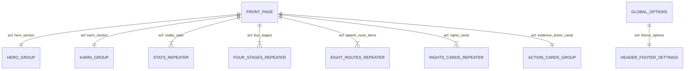

# 04 — Modelo de Datos (`DATA_MODEL`)

Aunque la **Fase 1** es estática (HTML/CSS/JS), el modelo de datos se diseña desde hoy para la **Fase 2 (WordPress + Advanced Custom Fields - ACF)** sobre la plantilla `front-page.php`.Cada sección de `index.html` mapea 1:1 con un grupo de campos ACF.

---

## 1. Diagrama de Entidades de Contenido (WordPress + ACF)

---

## 2. Definición de Grupos de Campos (Mapeo HTML → ACF)

### 2.1. `group_hero` (Sección 1: Hero Principal)
| Campo (`name`) | Tipo ACF | Valor por defecto en Fase 1 |
|---|---|---|
| `hero_title_line_1` | `text` | `EL CÁNCER YA ES UNA` |
| `hero_title_highlight` | `text` | `LUCHA.` |
| `hero_title_line_2` | `text` | `ACCEDER A UNA ATENCIÓN OPORTUNA ES` |
| `hero_title_script` | `text` | `la otra lucha` |
| `hero_image` | `image` | `assets/img/hero-mujeres.jpg` |
| `hero_cta_primary` | `link` | `CONOCE LA HISTORIA DE KARIN` (`#historia-karin`) |
| `hero_cta_secondary` | `link` | `CONOCE TUS DERECHOS` (`#conoce-tus-derechos`) |

### 2.2. `group_karin` (Sección 2: Testimonio de Karin Pardo)
| Campo (`name`) | Tipo ACF | Valor por defecto en Fase 1 |
|---|---|---|
| `karin_quote` | `text` | `"LA DETENCIÓN TEMPRANA PUEDE CAMBIARLO` |
| `karin_quote_script` | `text` | `todo"` |
| `karin_subtitle` | `text` | `KARIN PARDO: EL ROSTRO DE LA OTRA LUCHA` |
| `karin_bio` | `textarea` | `Karin Pardo tenía 26 años cuando detectó un bulto en su mama...` |
| `karin_photo` | `image` | `assets/img/karin-pardo.png` |
| `karin_cta` | `link` | `CONOCE LA HISTORIA DE KARIN` |

### 2.3. `group_reality` (Sección 3: La Realidad del Cáncer de Mama)
| Campo (`name`) | Tipo ACF | Subcampos / Valor |
|---|---|---|
| `reality_eyebrow` | `text` | `LA REALIDAD DEL CÁNCER DE MAMA` |
| `reality_heading` | `text` | `DETRÁS DE CADA cifra HAY UNA MUJER Y UNA RUTA DE ATENCIÓN.` |
| `reality_cta` | `link` | `CONOCE MÁS` |
| `reality_stats` | `repeater` (4 ítems) | `stat_prefix` (opc.), `stat_number` (`7,797`, `40%`, `7,685`, `21,945`), `stat_label` |

### 2.4. `group_four_fights` (Sección 4: Las 4 Luchas + Franja Morada)
| Campo (`name`) | Tipo ACF | Subcampos / Valor |
|---|---|---|
| `fights_heading` | `text` | `LA OTRA LUCHA COMIENZA CUANDO EL CAMINO SE LLENA DE BARRERAS` |
| `fights_box_title` | `text` | `Una paciente necesita mucho más que un diagnóstico` |
| `fights_box_body` | `wysiwyg` | `Después de detectar una señal de alerta, comienza una ruta...` |
| `fights_steps` | `repeater` (4 ítems) | `step_number` (`1`..`4`), `step_label` (*La lucha por conseguir atención*, etc.) |
| `fights_pillars` | `repeater` (4 ítems) | *Cada etapa importa*, *Cada etapa demora*, *Cada etapa merece ser investigada*, *Cada barrera debe poder visibilizarse* |

### 2.5. `group_patient_route` (Sección 5 y 6: La Ruta de la Paciente + Observatorio)
| Campo (`name`) | Tipo ACF | Subcampos / Valor |
|---|---|---|
| `route_heading` | `text` | `LA RUTA DE LA PACIENTE CON CÁNCER DE MAMA` |
| `route_Subheading` | `text` | `¿QUÉ BUSCAMOS CONOCER?` |
| `route_intro_box` | `wysiwyg` | `No queremos saber únicamente si una paciente consiguió atención...` |
| `route_items` | `repeater` (8 ítems) | `item_number` (`1`..`8`), `item_text` |
| `observatory_quote` | `text` | `ESCUCHAR A LAS PACIENTES ES EL PRIMER PASO PARA COMPRENDER QUÉ DEBE CAMBIAR` |
| `observatory_cta` | `link` | `CONOCE EL OBSERVATORIO ONCOLÓGICO` |

### 2.6. `group_rights` (Sección 7 y 8: Conoce tus Derechos + Evidencia y Acción)
| Campo (`name`) | Tipo ACF | Subcampos / Valor |
|---|---|---|
| `rights_eyebrow` | `text` | `CONOCE TUS DERECHOS` |
| `rights_heading` | `text` | `LA INFORMACIÓN TAMBIÉN ES UNA HERRAMIENTA DE lucha` |
| `rights_scenarios` | `repeater` (5 ítems) | `scenario_icon` (SVG/Image), `scenario_text` (*Si no consigo una cita*, etc.), `scenario_link` |
| `card_rights` | `group` | `title`, `title_script` (*importan*), `body`, `cta` (*EXPLORA LA GUÍA DE DERECHOS*) |
| `card_evidence` | `group` | `title`, `title_script` (*evidencia*), `body`, `cta` (*VISITA EL OBSERVATORIO ONCOLÓGICO*) |
| `card_action` | `group` | `title`, `title_script` (*acción*), `body`, `cta` (*EXPLORA LA GUÍA DE DERECHOS*) |

---

## 3. Modelo de Metadatos SEO y Entidades en Base de Datos (Rank Math)

### 3.1. Metadatos de Página (`wp_postmeta` para Post ID: 7 — "La Otra Lucha")
| Clave de Meta (`meta_key`) | Valor Almacenado (`meta_value`) | Propósito |
|---|---|---|
| `rank_math_title` | `La Otra Lucha \| Atención del Cáncer de Mama en Perú` | Title tag de 51 caracteres |
| `rank_math_description` | `Conoce La Otra Lucha: la ruta de atención del cáncer de mama en el Perú, el caso de Karin Pardo, el Observatorio Oncológico y la Guía de Derechos de la paciente.` | Meta description de 161 caracteres |
| `rank_math_focus_keyword` | `la otra lucha, cáncer de mama perú, ruta de atención oncológica` | Palabras clave objetivo |
| `rank_math_canonical_url` | `http://localhost/makeTheOtherStruggle/` | URL canónica fija |
| `rank_math_robots` | `a:1:{i:0;s:5:"index";}` | Directiva de indexación activa |
| `rank_math_advanced_robots` | `max-snippet:-1, max-video-preview:-1, max-image-preview:large` | Rich snippets extendidos |
| `rank_math_facebook_title` | `La Otra Lucha \| Por un Perú Sin Cáncer` | Título Open Graph |
| `rank_math_facebook_description`| `El cáncer ya es una lucha. Acceder a una atención oportuna es la otra lucha...` | Descripción Open Graph |
| `rank_math_facebook_image` | `.../assets/img/og-la-otra-lucha.jpg` | Imagen OG (Attachment ID: 9, 1200x630px) |
| `rank_math_facebook_image_id` | `9` | ID de medio en `wp_posts` |
| `rank_math_twitter_card_type` | `summary_large_image` | Tarjeta grande de Twitter / X |
| `rank_math_rich_snippet` | `article` | Tipo de Schema principal |
| `rank_math_seo_score` | `85` | Puntuación de optimización Rank Math |

### 3.2. Configuración Global (`wp_options`)
| Opción (`option_name`) | Valor / Estructura | Propósito |
|---|---|---|
| `site_icon` | `10` | Attachment ID del ícono de sitio (512x512px) |
| `rank_math_registration_skip`| `1` | Activa renderizado frontend sin registro cloud |
| `blog_public` | `1` | Permite el rastreo público del sitio por motores |
| `rank-math-options-titles` | Array serializado (`homepage_title`, `homepage_description`, etc.) | Fallback global de títulos y Open Graph |
