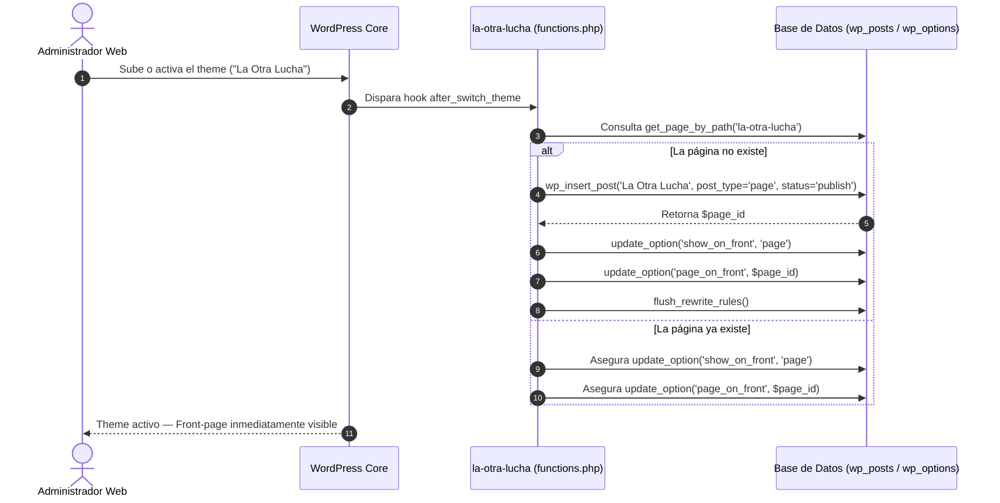

# 05 — Arquitectura del Proyecto (`ARCHITECTURE`)

## 1. Estructura de Directorios del Repositorio y Theme

```text
makeTheOtherStruggle/
├── wp-content/
│   └── themes/
│       └── la-otra-lucha/                  # Theme oficial activo de WordPress (v1.1.0)
│           ├── style.css                   # Metadatos del theme (v1.1.0, tags, autor)
│           ├── screenshot.png              # Miniatura oficial en 1200x900px
│           ├── readme.txt                  # Ficha técnica y changelog oficial
│           ├── functions.php               # Enqueue, auto-provisión de página y helpers
│           ├── front-page.php              # Orquestador One-Page principal
│           ├── header.php                  # <head>, favicons, PWA, defs SVG (#brush-stroke)
│           ├── footer.php                  # Cierre de <main>, pie de página y back-to-top
│           ├── page.php                    # Plantilla de páginas institucionales
│           ├── 404.php                     # Plantilla de error 404 accesible
│           ├── single.php                  # Plantilla de entradas individuales con meta
│           ├── archive.php                 # Plantilla de archivos con paginación
│           ├── search.php                  # Plantilla de resultados de búsqueda
│           ├── index.php                   # Fallback estándar
│           ├── template-parts/             # 8 componentes modulares de sección
│           │   ├── section-hero.php        # Hero con foto calada y botones CTA
│           │   ├── section-karin.php       # Testimonio de Karin Pardo
│           │   ├── section-reality.php     # Grilla 2x2 de estadísticas clave
│           │   ├── section-four-fights.php # Ruta de 4 luchas + franja morada de pilares
│           │   ├── section-patient-route.php # Ruta de investigación (8 dimensiones)
│           │   ├── section-quote-banner.php # Banner de cita del Observatorio
│           │   ├── section-rights.php      # 5 tarjetas de situaciones y derechos
│           │   └── section-action-trio.php # Bloques de derechos, evidencia y acción
│           ├── languages/
│           │   └── la-otra-lucha.pot       # Catálogo de internacionalización Gettext
│           ├── assets/
│           │   ├── fonts/                  # Blackrush.ttf, Veneer-Two.otf
│           │   ├── img/                    # hero-calado.png, favicons, og-image
│           │   └── svg/                    # Logotipos, íconos de derechos y redes
│           ├── css/
│           │   ├── variables.css           # Tokens de diseño (colores, fuentes, espacios)
│           │   ├── reset.css               # Reset y accesibilidad
│           │   ├── layout.css              # Contenedores, flex y grid
│           │   ├── components.css          # Botones, tarjetas y navegación
│           │   └── sections.css            # Secciones, animaciones y plantillas estándar
│           └── js/
│               ├── main.js                 # Inicializador ES Module
│               └── modules/
│                   ├── navigation.js       # Menú hamburguesa accesible y scroll-spy
│                   └── animations.js       # Contadores y animaciones de scroll
├── .well-known/
│   └── security.txt                        # RFC 9116 para reporte de vulnerabilidades
├── site.webmanifest / manifest.json        # Manifiestos de aplicación PWA
├── browserconfig.xml                       # Mosaicos para Windows / Edge
├── favicon.ico / favicon.svg / apple-*     # Suite raíz de favicons e íconos
├── llms.txt / llms-full.txt                # Estándar de documentación para agentes e IA
├── robots.txt                              # Directivas de rastreo para bots de IA y motores
├── .htaccess                               # Reescritura sitemaps, headers y hardening
├── docs/                                   # Documentación estándar del proyecto (01 a 10)
├── scripts/                                # Scripts de utilidad, verificación y seed
└── AGENTS.md                               # Memoria del proyecto para agentes de IA
```

---

## 2. Flujo de Auto-Aprovisionamiento y Ciclo de Vida (Theme Actualizable)

Para asegurar que el theme sea 100% instalable, reproducible y actualizable en cualquier entorno WordPress sin requerir intervención manual compleja:



---

## 3. Resiliencia y Principios de Actualización

1. **Sin Dependencias Duras:** El tema no lanza errores fatales si plugins como ACF Pro o Contact Form 7 no están activos. El helper `lol_get_field()` devuelve el contenido estático fiel de la maquetación.
2. **Actualización In-Place:** Cuando se sube una nueva versión del theme (ej. v1.1.0), los archivos del tema se reemplazan limpiamente. Como el contenido frontal reside en los templates modulares y la opción `page_on_front` ya está registrada en la base de datos, la web no se desconfigura ni pierde su asignación.
3. **Mapeo a ACF:** Si se instala ACF y se importan los grupos de campos, las funciones `lol_get_field('campo', 'fallback')` renderizan de inmediato los valores ingresados por el usuario desde el panel de control.
